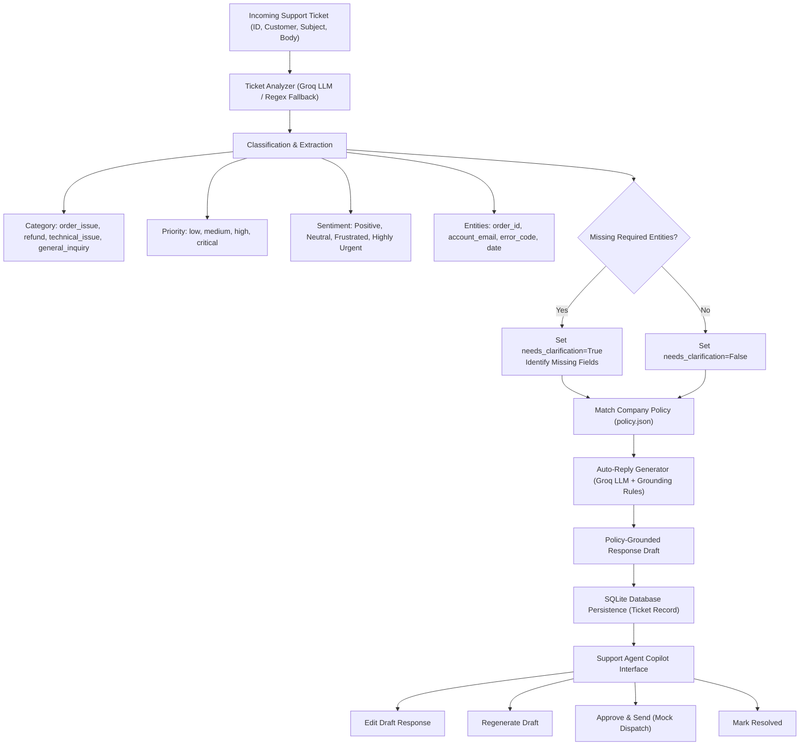

# AI Support Ticket Triage & Auto-Reply Copilot

An enterprise-ready, intelligent customer support triage and auto-reply copilot that classifies incoming support tickets, determines priority and category, assesses SLA adherence, cross-references internal company policies, and generates draft responses using the Groq API with Human-in-the-Loop approval, draft editing, ticket resolution, and dual CSV/JSON data exports.

---

## 🛠️ Technology Stack

| Layer | Technologies |
|---|---|
| **Frontend UI** | React 19, Vite 8, Lucide React icons, Vanilla Modern CSS Design System |
| **Backend API** | Python 3.10+, FastAPI, Starlette, Uvicorn (ASGI) |
| **AI / LLM** | Groq API (`openai/gpt-oss-120b`, `llama-3.3-70b-versatile`) with structured JSON schema output and deterministic fallback |
| **Database & ORM** | SQLite 3, SQLAlchemy 2.0 ORM |
| **Validation & Schema** | Pydantic v2, Pydantic Settings |
| **Testing & Verification** | Pytest, Starlette TestClient, Puppeteer Core (E2E browser screenshots) |

---

## 📁 Project Architecture & Directory Structure

```
AI support ticket triage and auto-reply copilot/
├── backend/                               # FastAPI Backend Application
│   ├── app/
│   │   ├── __init__.py                    # Package version & metadata
│   │   ├── config.py                      # Pydantic Settings, environment configs
│   │   ├── database.py                    # SQLite engine & SQLAlchemy session provider
│   │   ├── models.py                      # Ticket SQLAlchemy ORM model with final_response logic
│   │   ├── schemas.py                     # Strict Pydantic models for triage, analysis & exports
│   │   ├── main.py                        # FastAPI entrypoint, CORS & health routes
│   │   ├── routers/
│   │   │   └── tickets.py                 # Ticket CRUD, actions, triage, and CSV/JSON export routes
│   │   └── services/
│   │       ├── ticket_analyzer.py         # Category, priority, sentiment, entity extraction
│   │       ├── auto_reply_generator.py    # Policy grounding & draft generator with fallback
│   │       └── ticket_service.py          # SQLite repository, mock approval, resolve, export logic
│   ├── tests/
│   │   ├── test_analysis.py               # Unit tests for classification schemas
│   │   ├── test_five_scenarios.py         # 5 reference scenario evaluation tests
│   │   ├── test_phase4_auto_reply.py      # Policy grounding & grounding safety rules tests
│   │   └── test_phase6_ticket_management.py # Draft editing, mock approval, resolve, CSV/JSON tests
│   ├── policy.json                        # Standard operating support policies
│   ├── sample_tickets.json                # Realistic demonstration tickets
│   ├── test_tickets.json                  # Reference evaluation test tickets
│   └── requirements.txt                   # Backend dependencies
├── frontend/                              # React + Vite Application
│   ├── src/
│   │   ├── components/
│   │   │   ├── Badges.jsx                 # Category, Priority, Sentiment, Status & Approval badges
│   │   │   ├── Sidebar.jsx                # Responsive navigation sidebar with live counters
│   │   │   └── StatsCards.jsx             # Real-time metrics summary cards
│   │   ├── api.js                         # API client for triage, edits, approvals, exports
│   │   ├── App.jsx                        # Main workspace layout (Inbox + AI Copilot Pane + Reports)
│   │   ├── index.css                      # Modern SaaS CSS Design System
│   │   └── main.jsx                       # React DOM entrypoint
│   ├── take_screenshots.js                # Puppeteer script for automated evidence screenshots
│   ├── package.json                       # Frontend dependencies (React 19, Lucide, Puppeteer)
│   └── vite.config.js                     # Vite proxy & build configuration
├── evidence/                              # Phase 7 Verified Evidence Folder
│   ├── screenshots/                       # 12 actual Chrome headless screenshots
│   │   ├── 01_main_dashboard.png
│   │   ├── 02_ticket_inbox.png
│   │   ├── 03_order_issue_analysis.png
│   │   ├── 04_refund_analysis.png
│   │   ├── 05_technical_issue_analysis.png
│   │   ├── 06_missing_order_id_warning.png
│   │   ├── 07_generated_ai_response.png
│   │   ├── 08_draft_before_editing.png
│   │   ├── 09_draft_after_editing.png
│   │   ├── 10_approved_mock_response.png
│   │   ├── 11_resolved_ticket.png
│   │   └── 12_export_functionality.png
│   ├── exports/                           # Actual CSV and JSON exports from live SQLite DB
│   │   ├── actual_tickets_export.csv
│   │   └── actual_tickets_export.json
│   ├── classification_logs/               # Live Groq API classification logs
│   │   └── actual_classification.log
│   └── test_results/                      # Automated test outputs & comparison tables
│       ├── expected_vs_actual_table.md
│       ├── five_tickets_comparison.json
│       └── pytest_results.txt
├── pytest.ini                             # Pytest configuration
└── README.md                              # Complete system documentation
```

---

## ⚙️ Installation & Environment Configuration

### 1. Prerequisites
- **Python:** 3.10 or higher
- **Node.js:** v18 or higher (v22+ recommended)
- **Groq API Key:** Obtainable from [console.groq.com](https://console.groq.com)

### 2. Backend Setup
```bash
# Navigate to backend directory
cd backend

# Create virtual environment
python -m venv venv

# Activate virtual environment
# Windows PowerShell:
.\venv\Scripts\Activate.ps1
# Linux / macOS:
source venv/bin/activate

# Install dependencies
pip install -r requirements.txt

# Configure environment variables
copy .env.example .env
```

Edit `backend/.env` with your settings:
```env
APP_NAME="AI Support Ticket Triage & Auto-Reply Copilot"
ENVIRONMENT=development
PORT=8000
HOST=0.0.0.0
GROQ_API_KEY="your-groq-api-key-here"
GROQ_MODEL="openai/gpt-oss-120b"
ALLOWED_ORIGINS="http://localhost:5173,http://127.0.0.1:5173"
```
*(Note: If `GROQ_API_KEY` is not provided or rate limited, the backend seamlessly falls back to a deterministic, policy-grounded rule-based engine).*

### 3. Frontend Setup
```bash
# Navigate to frontend directory
cd ../frontend

# Install dependencies
npm install
```

---

## 🚀 Starting the Application

### 1. Start Backend Server
```bash
cd backend
python -m uvicorn app.main:app --port 8000 --reload
```
- **Backend API Docs:** `http://localhost:8000/docs`
- **Health Check:** `http://localhost:8000/health`

### 2. Start Frontend Development Server
```bash
cd frontend
npm run dev
```
- **Web App Dashboard:** `http://localhost:5173`

*(Alternatively, to run the optimized production build)*:
```bash
cd frontend
npm run build
npm run preview -- --port 5173
```

---

## 📡 API Endpoints Reference

| Method | Endpoint | Description |
|---|---|---|
| `GET` | `/health` | System health check and environment status |
| `POST` | `/api/v1/tickets/analyze` | Zero-shot AI ticket triage, entity extraction & sentiment detection |
| `POST` | `/api/v1/tickets/draft-reply` | Generate policy-grounded AI auto-reply draft without saving |
| `POST` | `/api/v1/tickets/process` | End-to-end triage: analysis, policy matching, draft reply & SQLite save |
| `GET` | `/api/v1/tickets` | Query and filter tickets (`category`, `priority`, `ticket_status`, `approval_status`) |
| `GET` | `/api/v1/tickets/{ticket_id}` | Retrieve single ticket record with full details |
| `PATCH` | `/api/v1/tickets/{ticket_id}` | Update ticket response draft, priority, or status |
| `POST` | `/api/v1/tickets/{ticket_id}/regenerate`| Re-run policy grounding to regenerate AI response draft |
| `POST` | `/api/v1/tickets/{ticket_id}/approve` | Approve response and execute mock email dispatch (DEMO ONLY) |
| `POST` | `/api/v1/tickets/{ticket_id}/resolve` | Mark ticket as resolved in SQLite and trigger dashboard stats refresh |
| `GET` | `/api/v1/tickets/ai-status` | Verify Groq API key configuration, model, and service health |
| `GET` | `/api/v1/tickets/stats` | Live computed statistics from SQLite database |
| `POST` | `/api/v1/tickets/seed-samples` | Seed pre-populated realistic demo tickets into SQLite |
| `GET` | `/api/v1/tickets/export/csv` | Download complete tickets dataset as CSV |
| `GET` | `/api/v1/tickets/export/json` | Download complete tickets analysis & responses as JSON |

---

## 🧠 AI Classification & Policy Grounding Pipeline



### 1. Categories
- **`order_issue`**: Shipping delays, carrier tracing, damaged items, incorrect items.
- **`refund`**: Return requests, money-back claims, defective product returns.
- **`technical_issue`**: HTTP 500 errors, checkout failures, account lockouts, login errors.
- **`general_inquiry`**: Product information, store operating hours, positive feedback, partnership requests.

### 2. Strict Entity Extraction
- **`order_id`**: Extracts patterns matching `#ORD-XXXXX`, `ORD-XXXX`, or numeric order numbers.
- **`account_email`**: Standard RFC-compliant email extraction.
- **`error_code`**: Technical error codes (e.g. `ERR-404`, `ERR-502`, `500`).
- **`date`**: Mentioned transaction or delivery dates.

### 3. Grounding Safety Rules
1. **Rule 1 (No Invented Order Numbers):** The AI will NEVER fabricate an order number or identifier not present in the customer message.
2. **Rule 2 (No Guessed Account Status):** The AI will not assert that an order was delivered or canceled without verification.
3. **Rule 3 (Mandatory Clarification Request):** If an order ID is missing for a refund or delivery inquiry, the model explicitly sets `needs_clarification=True` and drafts a polite request for the missing information.
4. **Rule 4 (No Unauthorized Refund Promises):** The AI will never promise an immediate payout; it frames replies around policy eligibility (30-day window, 5-7 business day inspection).

---

## 👨‍💻 Support Agent Copilot Features (Phase 6)

### 1. Interactive Draft Editing & Saving
- Agents can modify AI drafts directly in the response textarea.
- An **"Unsaved Changes"** indicator alerts agents to pending modifications.
- Clicking **"Save Draft"** persists the edited draft to the SQLite database via `PATCH /api/v1/tickets/{id}`.
- Re-querying or exporting automatically prioritizes `edited_response` as the `final_response`.

### 2. Draft Regeneration
- Clicking **"Regenerate Draft"** re-triggers the policy-matching engine, resetting manual edits and producing a fresh policy-grounded draft.

### 3. Mock Approval & Send
- **Approve & Send Workflow:** Saves the approved response and updates status to `approved`.
- **DEMO ONLY Safeguard:** Clearly informs the user via confirmation modal and toast:
  > **MOCK SENDING NOTICE:** *No real email was sent. This is a demonstration project.*
  
### 4. Ticket Resolution
- Clicking **"Mark Resolved"** updates `ticket_status` to `resolved` in SQLite.
- Live dashboard statistics, badge counts, and report graphs refresh immediately.

### 5. CSV and JSON Data Exports
- **CSV Export:** Includes exact required columns:
  `Ticket ID, Customer, Category, Priority, Sentiment, Missing entities, Status, Final response`
- **JSON Export:** Full export containing raw messages, extracted entities, missing entities, analysis details, response drafts, agent edits, approval status, and timestamps.

### 6. Dark Mode & Accessibility
- **One-Click Theme Toggle:** Easily toggle between Light Mode and Dark Mode via the sun/moon button in the top header or sidebar.
- **Persistent Preferences:** The user's preference is saved in `localStorage` and respects the OS `prefers-color-scheme`.
- **High-Contrast Design:** Dark theme surfaces (`#0b0f19`, `#111827`, `#1f2937`) optimize readability for long agent shifts.

### 7. Security Guardrails, Validation & P1–P3 Urgency UI
- **Prompt Injection Defense (`backend/app/services/security.py`):** Treats all customer text as untrusted input wrapped in `<untrusted_customer_input>` XML delimiters, detects instruction overrides / prompt-leak probes / unauthorized refund demands, keeps customer data intact for classification, and forces manual review.
- **Refund Policy Enforcement:** Reads refund rules and limits strictly from `backend/policy.json`, prevents invented monetary limits or unverified `"refund processed"` claims via deterministic backend post-validation, and clearly separates refund requests from approved refunds.
- **Input & Error Validation:** Rejects empty/whitespace-only messages and inputs exceeding `MAX_MESSAGE_LENGTH` (`10,000` chars) at both React and Pydantic layers; handles missing/invalid Groq API keys, rate limits, network errors, and malformed model JSON with secret-scrubbed user-friendly messages.
- **Urgency Badges:** Maps `critical`/`high` to **P1 (Red)**, `medium` to **P2 (Yellow)**, and `low` to **P3 (Gray)** while keeping the original priority visible in ticket details.

---

## 🧪 Testing Instructions

Run the full automated test suite (45 tests covering 10-ticket synthetic live Groq suite, 18 security/validation unit & API tests, 5-scenario baseline, policy grounding, draft editing, mock approval, resolution, and exports):

```bash
# Run all tests
python -m pytest backend/tests -v

# Run Security, Prompt Injection, Validation & Error Handling unit tests
python -m pytest backend/tests/test_security_and_validation.py -v

# Run 10-Ticket Synthetic Evaluation Suite (Live Groq API)
python -m pytest backend/tests/test_ten_synthetic_tickets.py -v
```

### Verified Test Suites
1. **[`test_security_and_validation.py`](backend/tests/test_security_and_validation.py)**: 18 unit & API tests verifying prompt injection isolation, backend refund guardrail overrides, sarcasm/mixed-category/clarification edge cases, whitespace & 10,000-char limits, and all 7 API key/error states without secret leakage.
2. **[`test_ten_synthetic_tickets.py`](backend/tests/test_ten_synthetic_tickets.py)**: 10 live Groq end-to-end tests matching [`test_tickets_10.json`](backend/test_tickets_10.json) (including sarcasm, mixed refund+tech, prompt injection, and incomplete clarification).
3. **[`test_five_scenarios.py`](backend/tests/test_five_scenarios.py)**: 6 integration tests verifying baseline triage scenarios.
4. **[`test_phase4_auto_reply.py`](backend/tests/test_phase4_auto_reply.py)**: 5 tests checking policy matching, grounding safety rules, and SQLite upsert.
5. **[`test_phase6_ticket_management.py`](backend/tests/test_phase6_ticket_management.py)**: 6 tests checking draft editing, saving, mock approval, resolution, CSV download formatting, and JSON analysis structure.

---

## 📂 Phase 7 Evidence Folder (`evidence/`)

All verification evidence has been generated directly from the live codebase and organized:

- **Screenshots (`evidence/screenshots/`):**
  1. `01_main_dashboard.png`: Full dashboard overview with KPI cards and sidebar.
  2. `02_ticket_inbox.png`: Ticket inbox list with search and badge filtering.
  3. `03_order_issue_analysis.png`: Triage view for Order Issue with extracted Order ID.
  4. `04_refund_analysis.png`: Triage view for Refund scenario.
  5. `05_technical_issue_analysis.png`: Triage view for Technical Issue with HTTP 500 error code.
  6. `06_missing_order_id_warning.png`: Missing Order ID alert banner.
  7. `07_generated_ai_response.png`: Policy-grounded AI auto-reply draft.
  8. `08_draft_before_editing.png`: Response draft prior to agent edits.
  9. `09_draft_after_editing.png`: Draft with custom agent modifications and "Unsaved Changes" indicator.
  10. `10_approved_mock_response.png`: Mock Approval confirmation dialog with demonstration notice.
  11. `11_resolved_ticket.png`: Ticket marked as Resolved with updated status badges.
  12. `12_export_functionality.png`: Reports panel with category/sentiment charts and Export buttons.
  13. `13_dark_mode_dashboard.png`: Dark mode dashboard layout with high-contrast surfaces.
  14. `14_dark_mode_detail.png`: Dark mode detail copilot workspace with response draft.
  15. `15_updated_dashboard.png`: Updated dashboard with P1–P3 urgency mapping and live AI status.
  16. `16_ticket_inbox_p1_p2_p3.png`: Ticket inbox showing P1 (Red), P2 (Yellow), P3 (Gray) & Security badges.
  17. `17_ticket_details_and_ai_analysis.png`: Ticket details displaying original priority, secondary categories, and extracted entities.
  18. `18_empty_state.png`: Search/filter empty state with recovery button.
  19. `19_input_validation_error.png`: New ticket modal input validation alert & character counter.
  20. `20_api_key_error_state.png`: User-friendly API key error banner without secret leakage.
  21. `21_prompt_injection_test_result.png`: Prompt injection attempt neutralized & flagged in AI analysis.
  22. `22_generated_customer_response.png`: Policy-grounded generated customer response draft.

- **10-Ticket & Security Verification (`evidence/`):**
  - `evidence/test_matrix_10_tickets.csv`: Expected vs. actual comparison matrix for all 10 synthetic tickets.
  - `evidence/test_results.json`: Full JSON records for all 10 tickets and adversarial security checks.
  - `evidence/classification_comparison.md`: Detailed classification analysis table across normal and edge cases.
  - `evidence/security_test_report.md`: Prompt injection protection & refund policy enforcement report.
  - `evidence/README.md`: Complete index of verification evidence.

- **Actual Data Exports (`evidence/exports/`):**
  - `actual_tickets_export.csv`: Live CSV download from SQLite with all 8 required headers.
  - `actual_tickets_export.json`: Live JSON download containing full ticket analysis details.

- **Test Results & Logs (`evidence/test_results/` & `evidence/classification_logs/`):**
  - `expected_vs_actual_table.md`: Comprehensive Markdown table comparing expected vs. actual benchmark results.
  - `five_tickets_comparison.json`: Complete JSON test log for the 5 reference tickets.
  - `pytest_results.txt`: Automated pytest output log.
  - `actual_classification.log`: Live server execution and Groq inference logs.

---

## ⚠️ Known Limitations

1. **Demonstration Project Scope:** This application is configured in demonstration mode. The "Approve & Send" feature records mock dispatches and logs simulated email events; it does not connect to external SMTP/SendGrid mailboxes.
2. **Groq API Rate Limits:** Free-tier Groq API keys may encounter temporary 429 rate limits during rapid bulk batch queries. The backend is configured with automatic backoff retry and a deterministic policy-grounded fallback engine to prevent failures.
3. **Single-Node SQLite:** SQLite is used for persistent local storage. For enterprise high-concurrency production deployments, switching `DATABASE_URL` to PostgreSQL in `backend/.env` is supported via SQLAlchemy.
